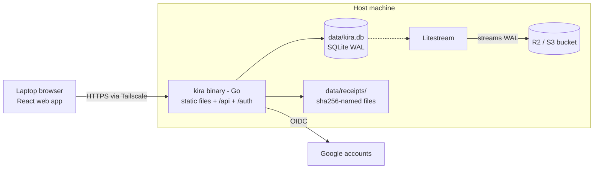

# TRD: Kira — Personal Business Expense Recorder

| Field | Value |
|---|---|
| Author | Jaxz |
| Status | Draft |
| Version | 0.1 |
| Last updated | 2026-11-09 |
| Related PRD | PRD-kira.md |

## 1. Overview & scope
A single Go binary that serves a desktop-first React web app and a JSON API, storing everything in one SQLite file on the host disk. The ledger is append-only (DB triggers) and hash-chained with an HMAC key, so any change made outside the app is detectable. Covers all PRD Must/Should items; FR-8, FR-9, FR-14 (Could) are deferred but the schema allows them.

## 2. Architecture



| Component | Responsibility |
|---|---|
| React web app (Vite, embedded via `go:embed`) | Dashboard, entries table + quick-add bar, entry detail |
| Go HTTP server (chi) | Auth, session check, API, serves the web app |
| Ledger service | Only code path that writes entries: computes hash chain under a lock |
| SQLite (WAL, `synchronous=FULL`) | Single source of truth, one file |
| Receipt store | Content-addressed files; hash stored in ledger |
| Litestream | Continuous off-machine backup of the DB |

**Deployment:** native binary run by systemd (Linux/WSL) or launchd (macOS). **No Docker.**

> On the Docker worry: Docker only loses data when it's written inside the container's own filesystem. A bind mount (`-v ./data:/data`) survives. But for one binary + one file, Docker adds nothing, so skip it.

## 3. Tech stack & rationale
| Layer | Choice | Why | Alternative considered |
|---|---|---|---|
| Backend | Go 1.23 + chi | Jaxz's daily stack; single static binary | Node/Express |
| Frontend | React + Vite + Tailwind | Fast to build; desktop-first layout | HTMX templates (fewer deps, less polish) |
| Database | SQLite via `modernc.org/sqlite` (pure Go, no cgo) | One file, zero ops, survives anything except disk loss | Postgres (needs a server), JSON file (no transactions) |
| Auth | Google OIDC: `golang.org/x/oauth2` + `coreos/go-oidc` | Verifies ID token signature properly | Firebase Auth (extra service) |
| Backup | Litestream → Cloudflare R2 | Continuous, cheap, restore = one command | Cron `sqlite3 .backup` to Google Drive |
| Network | Tailscale (+ `tailscale serve` for HTTPS) | Private access from any of your devices, no public port | VPS + Caddy + domain; or just `localhost` if you only use one laptop |

## 4. Data model
Money is stored as **integer sen** (`amount_sen`), never float.

```sql
CREATE TABLE entries (
  id           INTEGER PRIMARY KEY,          -- monotonic, = chain position
  kind         TEXT NOT NULL CHECK (kind IN ('create','amend','void')),
  ref_id       INTEGER REFERENCES entries(id), -- amend/void point at the ORIGINAL entry
  direction    TEXT NOT NULL DEFAULT 'expense' CHECK (direction IN ('expense','income')),
  occurred_on  TEXT,                          -- YYYY-MM-DD (null for void)
  amount_sen   INTEGER,                       -- null for void
  currency     TEXT NOT NULL DEFAULT 'MYR',
  category_id  INTEGER REFERENCES categories(id),
  payee        TEXT, method TEXT, note TEXT,
  void_reason  TEXT,
  receipt_sha256 TEXT,
  created_at   TEXT NOT NULL,                 -- server UTC timestamp
  prev_hash    TEXT NOT NULL,
  hash         TEXT NOT NULL UNIQUE
);

-- Append-only: the DB itself refuses edits, from the app or anyone else using a SQL tool
CREATE TRIGGER entries_no_update BEFORE UPDATE ON entries
BEGIN SELECT RAISE(ABORT, 'ledger is append-only'); END;
CREATE TRIGGER entries_no_delete BEFORE DELETE ON entries
BEGIN SELECT RAISE(ABORT, 'ledger is append-only'); END;

CREATE TABLE categories (id INTEGER PRIMARY KEY, name TEXT UNIQUE, color TEXT, icon TEXT, archived_at TEXT);
CREATE TABLE sessions  (token_sha256 TEXT PRIMARY KEY, created_at TEXT, expires_at TEXT, user_agent TEXT);
CREATE TABLE auth_log  (id INTEGER PRIMARY KEY, at TEXT, email TEXT, google_sub TEXT, result TEXT); -- also append-only (same triggers)
```

**Current state** = view `v_current`: for each original `create`, take its latest `amend` (if any), exclude if a `void` exists. Totals, lists and export read only this view; the entry detail screen reads the full chain.

**Hash chain (the tamper evidence):**
```
hash_n = HMAC_SHA256(LEDGER_KEY, prev_hash || canonical_json(row_n without hash))
prev_hash of entry 1 = "0" * 64
```
Triggers stop casual edits; someone could drop the triggers in a SQL tool, but they can't recompute valid hashes without `LEDGER_KEY`, which lives only in the app's env file and Jaxz's password manager. Deleting rows from the end is caught by comparing the last `id`/`hash` against the latest Litestream backup and a "head" value logged on every startup.

## 5. API design
All `/api/*` require a valid session cookie; middleware re-checks the session's email/sub against the allow-list on **every** request.

| Method | Path | Purpose | Auth | Maps to |
|---|---|---|---|---|
| GET | /auth/google/login | Start OIDC (state + PKCE) | Public | FR-1 |
| GET | /auth/google/callback | Verify ID token, allow-list check, set cookie | Public | FR-1, FR-2 |
| POST | /auth/logout | Delete session | Session | FR-1 |
| GET | /api/me | Current user | Session | FR-1 |
| GET | /api/entries?from&to&category&method&q | List current entries | Session | FR-11 |
| POST | /api/entries | Create entry | Session | FR-3 |
| GET | /api/entries/:id/history | Full version chain | Session | FR-4, FR-5 |
| POST | /api/entries/:id/amend | Append corrected version | Session | FR-4 |
| POST | /api/entries/:id/void | Append void with reason | Session | FR-5 |
| POST | /api/receipts | Upload (multipart) → returns sha256 | Session | FR-6 |
| GET | /api/receipts/:sha256 | Serve receipt | Session | FR-6 |
| GET/POST/PATCH | /api/categories | Manage categories | Session | FR-7 |
| GET | /api/summary?month=YYYY-MM | Totals, by category, 6-mo trend | Session | FR-10 |
| GET | /api/export?from&to&format=csv\|zip | CSV (+ receipts zip) | Session | FR-12 |
| GET | /api/ledger/verify | Recompute chain | Session | FR-13 |

Example — `POST /api/entries`
```json
// request
{ "occurred_on": "2026-11-09", "amount_sen": 4590, "category_id": 1,
  "payee": "Cloudflare", "method": "card", "note": "R2 + domain", "receipt_sha256": null }
// 201 response (only after the transaction is committed to disk)
{ "id": 128, "kind": "create", "amount_sen": 4590, "hash": "9f1c…", "created_at": "2026-11-09T03:12:44Z" }
```

## 6. Technical requirements
| ID | Requirement | Implements | Notes |
|---|---|---|---|
| TR-1 | OIDC auth-code flow with `state` + PKCE; ID token signature, `iss`, `aud`, `exp` verified via go-oidc | FR-1 | |
| TR-2 | Allow-list: `email_verified == true` AND `email == ALLOWED_EMAIL` AND `sub == ALLOWED_SUB` (sub pinned after first login; email can change, sub can't) | FR-2, NFR-1 | Reject → 403 page, log to `auth_log`, no session |
| TR-3 | Session = 32 random bytes, cookie `HttpOnly; Secure; SameSite=Lax`, stored as SHA-256, 30-day expiry; middleware re-validates allow-list per request | FR-1, FR-2 | Changing `ALLOWED_EMAIL` instantly locks out old sessions |
| TR-4 | All entry writes go through one `LedgerService.Append()` holding a mutex + `BEGIN IMMEDIATE` transaction; computes `prev_hash`/`hash` | FR-3–5, NFR-3 | Single writer = no chain forks |
| TR-5 | SQLite PRAGMAs: `journal_mode=WAL`, `synchronous=FULL`, `foreign_keys=ON`; API returns 201 only after commit | FR-3, NFR-2 | This is the "real-time, never lost" guarantee |
| TR-6 | Append-only triggers on `entries` and `auth_log` | FR-4, FR-5, NFR-3 | Corrections are new rows, never UPDATE |
| TR-7 | `/api/ledger/verify` + on-startup verify; result shown in UI and logged; startup logs head `id:hash` | FR-13, NFR-3 | Fail = red banner, app stays read-only until acknowledged |
| TR-8 | Receipts stored as `data/receipts/<sha256>.<ext>`, max 10 MB, JPEG/PNG/PDF only, re-encoded images stripped of EXIF GPS | FR-6 | Hash in ledger makes swapped receipts detectable |
| TR-9 | `v_current` view drives list/summary/export | FR-10–12 | |
| TR-10 | CSV columns: date, category, payee, method, amount_myr, note, status, entry_id, receipt_file | FR-12 | Amounts formatted from sen |
| TR-11 | Litestream replicates `kira.db` to R2 every 10 s; nightly rsync of `receipts/` | NFR-4, NFR-5 | |
| TR-12 | Data dir `chmod 700`, files `600`, owned by the service user | NFR-3, NFR-8 | |
| TR-13 | Desktop-first responsive layout; quick-add bar fully keyboard-driven (`N` focuses it, Tab order date→amount→category→payee→method→note, Enter saves) | NFR-7 | No PWA / service worker in v1 |
| TR-14 | Category seed on first run | FR-7 | |

## 7. Security & compliance
- **Auth:** Google OIDC, server-side verification only; never trust email sent from the frontend. Allow-list checked at login and on every request (TR-2, TR-3).
- **Secrets:** `.env` (chmod 600) holds `GOOGLE_CLIENT_ID`, `GOOGLE_CLIENT_SECRET`, `ALLOWED_EMAIL`, `ALLOWED_SUB`, `LEDGER_KEY` (32 random bytes, hex), `R2_*`. **Back up `LEDGER_KEY` in a password manager** — lose it and you can't verify the chain (data is still readable).
- **Network:** no public port. Tailscale only (or plain localhost on one machine); `tailscale serve` provides HTTPS and Secure cookies.
- **Input validation:** amount > 0 and < RM 10,000,000; dates within ±1 year of today unless confirmed; text fields length-capped; parameterised SQL only.
- **Rate limiting:** login endpoints 10/min/IP.
- **Honest limit:** this is tamper-*evident*. Someone with full control of the machine can delete the DB; backups + head-hash logging cover that. Optional v1.1: SQLCipher encryption at rest (needs cgo build).
- **Compliance:** no funds handled → no BNM/SC scope. Keep 7 years of records (LHDN). PII = only Jaxz's own data.

## 8. Infrastructure & environments
- **Envs:** `local` (laptop, `http://localhost:8080`) and `prod` (home machine/VPS via Tailscale). Separate Google OAuth redirect URIs registered for each.
- > ⚠️ Assumption: Google accepts the `https://<machine>.<tailnet>.ts.net/auth/google/callback` redirect. If it refuses, fall back to a VPS with a real domain + Caddy.
- **Run:** `make build` → `./kira` ; systemd unit `kira.service` with `Restart=always`, plus `litestream.service`.
- **Logs:** structured `slog` JSON to journald; verify failures and rejected logins at WARN.
- **Restore drill:** `litestream restore -o kira.db r2://bucket/kira.db` then `./kira verify`.

## 9. Testing strategy
| Risk area | Test | Tool |
|---|---|---|
| Ledger chain & triggers | Append, amend, void, then tamper via raw SQL (drop trigger, edit amount) → verify must fail at that id | Go table-driven tests |
| Allow-list | Forged/expired token, wrong email, right email wrong sub, `email_verified=false` → all 403 | Go tests with fake OIDC signer |
| Durability | Kill -9 during writes; restart; every 201'd entry present | Go integration test |
| Money math | Sen ↔ RM formatting, summary totals with amends/voids | Go unit tests |
| Happy path UI | Login → add → amend → void → export | Playwright (desktop viewport) |

## 10. Risks & mitigations
| Risk | Likelihood | Impact | Mitigation |
|---|---|---|---|
| Disk/laptop dies | Med | High | Litestream to R2 + receipts rsync; quarterly restore drill |
| `LEDGER_KEY` lost | Low | Med | Store in password manager; data remains readable without it |
| Google rejects tailnet redirect URI | Med | Med | VPS + domain fallback (TR documented) |
| Host machine asleep when on the go | Med | Med | Disable sleep / use always-on mini PC; or move to VPS |
| Over-engineering delays daily use | Med | Med | Ship M1–M2 first; log expenses from day 2 |

## 11. Estimation & sequencing
Critical path: **TR-5/6/4 (ledger) → TR-1–3 (auth) → UI add + list**.

| # | Task | Size |
|---|---|---|
| 1 | Repo, Go server, SQLite + migrations + triggers, seed categories | S (1–2 h) |
| 2 | LedgerService append/amend/void + hash chain + verify + tests | M (3 h) |
| 3 | Google OIDC + allow-list + sessions + tests | M (2–3 h) |
| 4 | API: entries, summary, categories | S (2 h) |
| 5 | Web UI: Login, Dashboard, Entries + quick add, Entry detail | M (4 h) |
| 6 | Receipts + CSV/zip export | S (2 h) |
| 7 | systemd + Tailscale + Litestream + restore drill | S (1–2 h) |

Parallelizable: frontend (5) against mocked API while 2–3 are built. Rough total: ~2 focused days.
